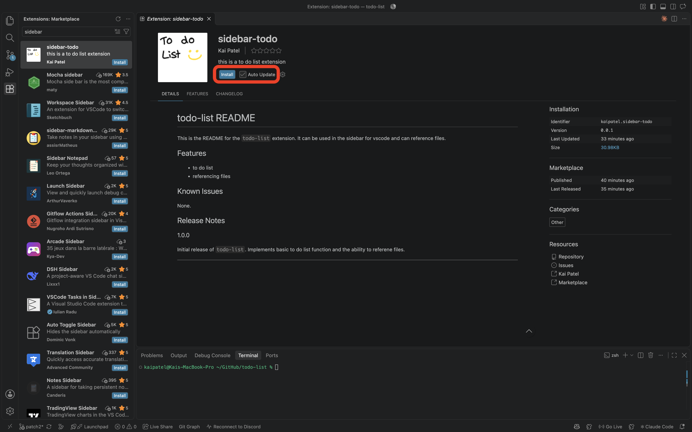
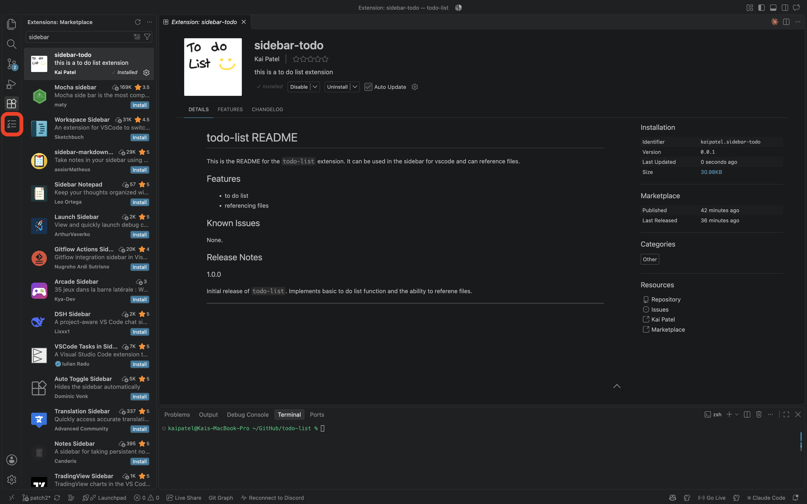
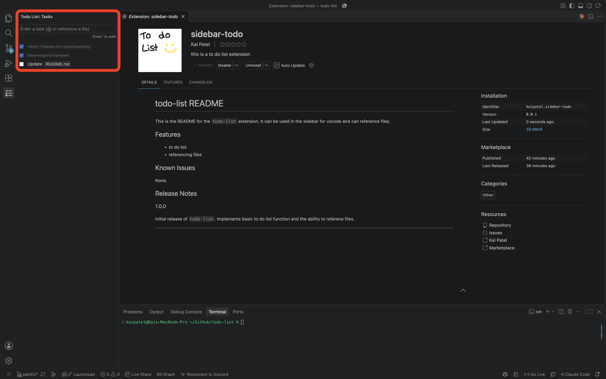

# todo-list README

This is the README for the `todo-list` extension. It can be used in the sidebar for vscode and can reference files.

## Install steps

1. Search for `sidebar-todo` in the Extensions Marketplace and click **Install**.

   

2. Once installed, click the new **Todo List** icon in the Activity Bar on the left.

   

3. The Todo List opens in the sidebar. Type a task and press `Enter` to add it, using `@` to reference a file.

   

## Features

- to do list
- referencing files (use @)

## Known Issues

None.

## Release Notes

### 1.0.0

Initial release of `todo-list`. Implements basic to do list function and the ability to referene files.

### 1.1.0

Reduced vscode version requirements (1.120.0 --> 1.74.0). 

Updated the todo logic to allow for clicking on text to edit it and clicking in any blank space on the todo to toggle completed

---
